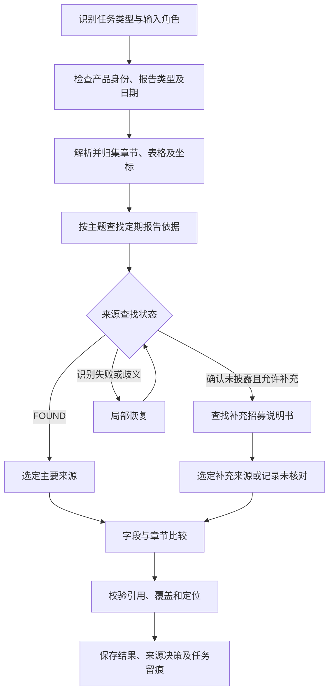

# 定期报告主校验与概要补充来源实施计划

- 日期：2026-11-06
- 工作分支：11-06
- 状态：实施中。输入契约、v2 来源规则、适配检查、双侧结果展示和一次受限引用恢复已落地；真实语料主流程可运行，但尚有指标待复核，章节召回、完整性能基线及多次稳定性验收未完成。
- 需求依据：用定期报告校验招募说明书；用定期报告校验产品资料概要，概要中的指定指标允许使用招募说明书补充校验。
- 适用关系：本计划替代《2026-11-06-章节比较与产品资料概要核对实施计划》中与文件组合、来源优先级、补充条件冲突的约定；原计划中的语料记录保留为历史参考。

## 1. 目标与完成条件

交付两种明确的任务类型，并共享章节归集、指标识别、证据定位、任务历史和审计能力。

| 任务类型 | 被校验文档 | 主要依据 | 补充依据 |
| --- | --- | --- | --- |
| 招募说明书核对 | 招募说明书，必需 | 定期报告，必需 | 本期不设置 |
| 产品资料概要核对 | 产品资料概要，必需 | 定期报告，必需 | 招募说明书，可选，仅指定指标可使用 |

概要任务允许输入三份文件，但每个指标最终只选择一份有效依据。比较及页面框选始终落到“被校验内容 + 该指标选定来源”的一对证据。

完成条件：

1. 两种任务都以定期报告为主要依据；概要任务不再被接口强制限制为“概要 + 招募说明书”。
2. 每个概要指标保存明确的来源选择结果；使用补充招募说明书不会产生“部分核对”状态。
3. 定期报告已有有效证据时，以该证据给出一致或差异结论，不因差异而转用补充文件。
4. 识别失败、候选检索为空、模型漏项都不能直接当成“报告未披露”。
5. 保留完整相关章节和跨页表格上下文；每项有效结论均可追溯到文档、物理页、原文及坐标。
6. 双方确认均无相关内容时跳过；目标有内容但没有有效依据时记录未核对原因；模型或定位失败时保留待复核。
7. 旧任务及原有三个投资组合模块继续可用，新任务使用独立规则及结果版本。
8. 给出基于固定语料的准确性、覆盖、定位、运行耗时和缓存效果记录。

## 2. 当前源码与需求的差距

以下为 2026-11-06 当前源码盘点，运行服务与前端构建包是否同步需在实施前另行确认。

| 位置 | 当前行为 | 必须调整的方向 |
| --- | --- | --- |
| app/main.py 的概要创建接口 | 要求概要和招募说明书，并拒绝定期报告 | 要求概要和定期报告，接受可选补充招募说明书 |
| frontend/src/components/UploadDialog.vue | 概要模式的文件角色仍随前次方案调整 | 固定两个必需文件，增加一个可选补充文件位置 |
| rules/product_summary/product_summary_v1.json | roles 数组只列参考来源，缺少优先级和切换条件 | 引入版本化的主要来源与补充来源策略 |
| app/summary_check.py | 按关键词及附近文字生成候选，最多 42 行 | 先选完整相关章节，再按表格、条款和指标边界控制输入 |
| app/summary_check.py | 提取和比较混在主题模型调用中，无法独立确认未披露 | 分开记录发现内容、确认来源、比较结果和引用校验 |
| app/runtime.py 的概要图 | 主要为加载文件、比较两个节点 | 增加适配检查、来源选择、补充查找及覆盖检查 |
| 概要结果聚合 | 已核对项一致时可能直接给整体 MATCH | 同时表达已核对结果和未核对覆盖情况 |

可以复用的基础：原有 AnyDoc/PyMuPDF 章节及表格处理、app/chapter_sources.py 来源记录、PDF Viewer、LangGraph 注册、var/tasks 任务目录和历史查询。

实施前先检查 git 状态和当前分支，记录现有未提交改动；不将既有源码、测试或构建包改动视为可丢弃内容。

## 3. 输入、身份与日期约定

### 3.1 文件角色

- target：被校验的招募说明书或产品资料概要。
- primary_reference：定期报告，识别其季度、中期或年度子类型。
- supplementary_reference：仅概要任务使用的补充招募说明书。
- 年度报告属于定期报告子类型，不再设计为第四种独立上传类别。
- 每个输入保留真实 document_id、文件哈希、文件名、识别类型和原有角色，不能只靠文件名判断类型。

### 3.2 身份检查

所有文件均检查基金身份；有份额类别时同时识别份额类别。补充文件也必须通过检查。基金名称简称、基金主代码及份额代码分别处理，不能将不同份额代码直接当成不同基金，也不能只凭相似简称认定相同。

明确身份冲突时阻断该任务或拒绝使用冲突的补充文件，并给出对应文件及身份依据。无法确定身份时保留未确认状态，不默认为通过。

### 3.3 日期检查

保存编制日、送出日、封面日期、数据截止日、报告期间和条款适用日期，并保留各自原文证据。

按指标判断适用性：

- 投资组合比较按目标章节披露的数据截止日与报告期间建立对应关系，不能只按招书封面日期判断。
- 概要默认使用编制时点已经披露且适用的报告；存在不适用日期时给出明确原因。
- 招募说明书补充内容须具有适用的版本或生效依据；日期不确定时不能假定其条款适用于概要编制日。
- “日期相差不超过固定天数”只可作为辅助提示，不能代替字段所属期间判断。
- 主要报告日期不适用时，不能通过切换到补充文件静默绕过检查。

本期保留手工上传报告的方式；自动从外部获取最近一期报告不在本期范围内。

## 4. 指标规则与来源选择

### 4.1 规则结构

新增 product_summary_v2 规则，保留 v1 快照供历史任务追溯。每条规则维护：

| 字段 | 含义 |
| --- | --- |
| key、label、excel_source_cell | 稳定指标标识、名称和 Excel 来源 |
| meaning、value_type | 字段业务含义及文本、日期、金额、费率等类型 |
| primary_source | 主要来源角色、适用报告子类型、章节提示 |
| fallback_source | 可选补充来源角色、章节提示；未配置即不允许补充 |
| fallback_when | 允许转入补充来源的条件 |
| period_policy、unit_policy | 必要的期间、单位和口径约束 |
| comparison_policy | 数字归一化要求或语义比较要求 |

不写入具体基金名称、数值、行号、固定页码或坐标。章节提示用于查找，模型负责理解实际标题、字段身份和语义关联。

### 4.2 首轮 16 项范围

下表为实施初始策略。实施时逐项复核 Excel 与样本；扩充补充来源必须有规则依据和版本记录。

| Excel 序号 | 指标 | 主要处理方式 | 招募说明书补充策略 |
| --- | --- | --- | --- |
| 1–2 | 基金简称、基金代码 | 定期报告的产品概况 | 首轮不自动补充，避免混淆主代码、份额代码和不同简称 |
| 3–4 | 基金管理人、基金托管人 | 优先定期报告 | 确认报告未披露且基金身份、适用日期成立时允许补充 |
| 5 | 基金合同生效日 | 定期报告 | 首轮不自动补充；后续有明确规则和样本后再开放 |
| 6–7 | 基金经理、任职日期 | 定期报告，绑定经理、本基金及任职记录 | 首轮不自动补充，避免历史履历或不同基金记录串用 |
| 8 | 场内简称、扩位简称 | 定期报告，按简称角色分别比较 | 首轮不自动补充 |
| 9–12 | 投资目标、策略、业绩比较基准、风险收益特征 | 定期报告，保留完整限制条件 | 首轮不自动补充；后续按条款适用性逐项开放 |
| 13–14 | 管理费率、托管费率 | 定期报告仅在明确披露同一合同年费率时可用 | 允许按招募说明书对应条款补充；报告实际费用、期间折算值不作为同一指标 |
| 15–16 | 审计费用、信息披露费 | 要求适用年度报告中的相同期间及口径金额 | 仅在招书明确披露相同期间、相同性质金额且规则允许时补充；收费公式或合同条款不能替代实际金额 |

对 13–14 等已知主要来源经常不包含同口径数据的项，可在确认报告子类型及字段适用范围后直接路由到允许的补充章节，避免重复模型调用；路由原因仍需留痕。

概要预估费用与年报实际费用是否属于可直接核对口径，需要在规则中明确。无法建立相同口径时记录“口径不适用”，不制造一致或差异结论，也不将差异自动解释为违规。

### 4.3 来源选择状态

来源查找与比较结果使用独立字段，内部来源状态至少包括：

- FOUND：找到业务身份、期间和口径均适用的内容。
- CONFIRMED_ABSENT：检查相关完整章节后确认未披露，保存检查范围及依据。
- NOT_APPLICABLE：来源或指标口径不适用，保存原因。
- EXTRACTION_FAILED：解析、模型输出、引用或定位失败。
- AMBIGUOUS：存在多个无法唯一确认的候选。

关键词未命中、候选为空、模型返回空值或超时都不能单独形成 CONFIRMED_ABSENT。

来源选择顺序：

1. 定期报告存在 FOUND 证据：选择该证据比较，即使比较结果存在差异。
2. 定期报告确认未披露，或规则明确该报告子类型不适用该字段：只有 fallback_when 允许时才查找补充文件。
3. 定期报告为 EXTRACTION_FAILED 或 AMBIGUOUS：先进行一次有边界的恢复；仍失败则待复核，不能直接替换主要来源。
4. 补充文件未提供：记录缺少补充依据；不要求整个任务失败。
5. 补充文件也无适用证据：记录未核对原因，不能继续向未声明的来源扩展。
6. 原定期报告与补充来源内容不同：保存检索过程，但不能选用更接近目标值的来源覆盖主要依据。

## 5. 章节、跨页内容与证据

### 5.1 共享文档目录

在现有来源目录基础上统一表达文档、章节、段落、逻辑表、表格片段、行和单元格。来源记录包含：文档哈希、解析版本、source_id、章节路径、物理页、坐标、原文及父子关系。

- AnyDoc 提供文档内容及结构线索；PyMuPDF 提供可验证的文字、表格与页面坐标。
- 同一章节跨页时保留完整相关内容，过滤页眉页脚但保留其原始记录。
- 跨页表格建立逻辑表与原始片段关系；续页表头、表尾、合计及跨行文本均保留。
- 概要的标签值布局要绑定标签和真实值，不能将同一个数字在全文的首个命中当成字段证据。
- 普通文本保留否定、范围、条件、适用对象，避免只摘出数字或短语。

### 5.2 候选获取与模型输入

替换固定 42 行裁剪：先通过章节标题、字段线索和已有解析目录查找候选章节；在完整相关章节内按条款或逻辑表提取主题证据包。输入过长时按条款或业务行拆分，携带表头、单位、期间和父章节上下文。

关键词召回不足时允许章节内语义查找；引入新的检索服务前先评估现有章节索引是否足够，避免首轮增加不必要的基础设施。

每次比较模型调用仅接收目标片段及已经选定的一份参考片段。来源判定阶段可以检查多个候选，但不能让模型在比较时自由选择与目标更接近的文件。

### 5.3 引用校验

- source_id 必须属于本任务、本指标候选及当前选择的文档。
- 数字、日期、代码与引用原文相符，并校验字段身份及单位；仅验证数字曾出现在一组片段中不足以确认其归属。
- 合并文字可引用多段 source_id，保留每段原文及独立坐标。
- 比较结论与定位精度分别保存。定位失败不能修改已经确认的业务值或伪装成内容不存在。
- 每项记录 row/cell、text_span、page 等定位精度；页面级回退须明确标注。

## 6. LangGraph 编排

保留两种 workflow ID，复用共同节点和证据契约，不先重写现有投资组合引擎。

图中的局部恢复循环最多执行一次；仍失败时进入待复核结果，不能形成无限重试。没有选定有效依据的项直接进入覆盖检查，不调用比较模型。

建议节点及职责：

| 节点 | 输入/输出及职责 |
| --- | --- |
| validate_inputs | 确认任务类型、目标、主要依据和可选补充依据 |
| preflight | 所有参与文件的身份、类型和日期证据 |
| build_sources | 建立或读取共享解析目录 |
| discover_primary | 输出各指标主要来源状态及候选证据 |
| resolve_supplement | 对允许补充的指标选择补充依据；招书任务跳过此节点 |
| compare_topics | 对已选定的证据按产品、投资、费用等主题执行比较 |
| validate_results | 校验引用、目标指标覆盖、重复结果和定位精度 |
| persist_result | 保存版本化结果及完整过程产物 |

任务进度展示对应用户可理解的阶段：文件检查、文档解析、指标定位、补充校验、结果核对。没有补充项时该阶段记为不需要执行。

## 7. 接口、规则版本与结果结构

### 7.1 创建任务

- 保留现有招书任务接口及 workflow ID，避免影响已有调用。
- 调整概要接口：product_summary 和 periodic_report 必需，prospectus 可选。
- 拒绝缺少主要定期报告的概要任务，返回明确的文件角色提示。
- 取消独立 annual_report 上传入口，报告子类型写入 periodic_report 元数据。
- 新任务保存 input_contract_version、rules_version、result_schema_version 和所有实际文件角色。
- 规则升级为 product-summary-v2，结果结构升级到新版本；旧任务读取时按原 schema 解释，不能重新标成新规则的结果。

### 7.2 每项结果

每项至少保存：

| 字段 | 说明 |
| --- | --- |
| key、label、excel_source_cell | 规则身份及来源 |
| target | 目标值、原文及证据 |
| primary_lookup | 主要依据查找状态、检查范围和失败/不适用原因 |
| fallback_lookup | 是否触发、规则条件、补充候选与结论 |
| selected_reference | 实际使用的文件、字段值、原文和证据 |
| source_selection_reason | 选择主要或补充依据的理由 |
| comparison_status | MATCH、MISMATCH、UNRESOLVED 或 NOT_CHECKED |
| reason_code | 未核对、待复核或不适用的结构化原因 |
| evidence_status | 定位是否成功及精度 |

内部允许 NO_COMMON_CONTENT 表示双方确认均无内容，此类项目可从默认列表隐藏，但审计记录必须保留。

### 7.3 汇总规则

- 使用补充来源后完成比较，仍按一致或差异展示，不引入“部分核对”。
- 目标有内容但无有效依据，计入未核对，不计为数据差异。
- 提取、模型、引用或定位问题计入待复核，不能作为正常跳过。
- 汇总分别返回 checked、matched、mismatched、unresolved、not_checked、no_common_content 数量，以及各来源实际使用数量。
- 存在未核对项时表达“已核对项一致，另有 N 项未核对”；不能以一个 MATCH 暗示全部规则已经核对。
- 没有任何实际比较时不得显示一致。
- 任务是否完成与业务结论分开：任务完成可以同时存在差异或未核对项。

## 8. 前端与历史记录

### 8.1 上传弹窗

只保留两种任务选项：招募说明书核对、产品资料概要核对。

- 招书模式：招募说明书和定期报告两个上传位置。
- 概要模式：概要和定期报告两个必需位置；补充招募说明书使用折叠或次要区域呈现。
- 不展示四种平级文件类别，不暴露不产生实际作用的时点开关。
- 未提供补充招书时可以创建概要任务；需要该来源的指标记录未核对原因。

### 8.2 结果页

- 左侧结果列表按被校验文档章节或主题组织。
- 左 PDF 固定为被校验文档；右 PDF 默认定期报告。
- 点击指标后，右 PDF 根据 selected_reference 自动切换到实际来源；两侧分别定位并框选。
- 显示简短来源信息：依据定期报告，或依据补充招募说明书；需要时可展开查看主要来源未采用原因。
- 一致项也支持双侧定位；不得将另一文档的坐标回退显示在当前 PDF 上。
- 保持现有金融场景样式，遵循 Radix 色彩、0.5px 边框、最小 12px 和精简说明要求。

### 8.3 历史任务

按任务 ID 保留原始结果和规则快照；新代码不能自动重写旧任务的结论。历史结构适配仅用于正确展示，重新核对须创建新任务 ID，并可记录 parent_task_id。

## 9. 性能与稳定性

1. 文档解析按文件哈希、解析器版本及解析配置缓存，复用定期报告及补充招书的目录。
2. 规则、主题证据及模型结果缓存需包含规则/提示版本、模型配置、目标时点、所选来源等上下文，避免错误复用。
3. 文档解析使用已有 PDF 工作池；避免在异步请求中同步解析整份 PDF 阻塞其他任务。
4. 产品信息、投资信息和费用信息使用有上限的主题并发；补充查找仅针对确需补充的指标。
5. 模型遗漏项、无效引用或不完整 JSON 仅重试受影响主题/指标，已有有效结果继续保留。
6. 首轮只增加一次有边界的局部恢复，不执行所有指标多模型重复投票。
7. 记录冷解析、缓存解析、主题查找、补充查找、比较和定位各阶段耗时，以及模型调用数、输入输出量和缓存命中。

性能目标通过同语料、同模型配置的前后对照制定。实施前不承诺固定秒数；任何提速必须同时报告覆盖率及证据质量，不能通过少比较指标获得提速结论。

## 10. 任务留痕

沿用 var/tasks/{task_id}，新增或完善：

- 输入角色、文件哈希、文档类型及日期证据。
- 本次规则快照和输入/结果契约版本。
- 每个指标的目标发现记录、主要来源查找状态、检查范围。
- 补充触发条件、候选、选择与拒绝原因。
- 主题模型请求、原始响应、解析错误及局部重试记录。
- 选定依据、逐字引用、坐标及定位精度。
- 覆盖清单、未核对原因和阶段耗时。

记录可核验的输入、输出和决策事实，不要求保存模型私有思维链；日志及产物不得记录访问密钥。

## 11. 实施阶段与改动位置

按以下顺序执行，每阶段通过退出条件后进入下一阶段。阶段之间保存可审查的改动，不自动提交或推送。

| 阶段 | 主要文件/建议新增模块 | 交付内容 | 退出条件 |
| --- | --- | --- | --- |
| P0 口径与基线 | 现有计划、assets、tests、git 状态 | 固定语料哈希、文件日期、现有任务结果与受影响用例 | 16 项来源策略和预期明确；现有未提交工作得到保护 |
| P1 输入与契约 | app/main.py、app/runtime.py、UploadDialog.vue、product_summary_v2.json | 概要+定期报告必需、补充招书可选；版本化角色和规则 | 正确组合可创建任务；缺主要依据和身份冲突明确拒绝；不再误要求只上传招书 |
| P2 主要/补充来源 | app/summary_check.py；建议新增 app/reference_selection.py | 来源状态、优先级、补充条件与一次局部恢复 | 主要依据有效时不切换；识别失败不伪装未披露；补充使用原因可追溯 |
| P3 章节与证据 | app/extraction.py、app/chapter_sources.py；建议新增 app/document_sources.py | 共享章节/逻辑表目录，替换固定行数裁剪，完善引用校验 | 跨页和长条款完整；选定值绑定正确字段、文档与坐标 |
| P4 结果与审计 | app/runtime.py、app/audit.py、概要结果契约 | 覆盖状态、已比较与未核对汇总、版本化产物 | 无实际比较不显示一致；旧任务按旧版本可读 |
| P5 双栏与历史 | ProductSummaryWorkbench.vue、Workbench.vue、TaskList.vue、PdfViewer.vue、styles.css | 来源自动切换、双侧定位、覆盖数量及历史展示 | 一致/差异/补充来源项都能定位到正确两份 PDF；页面无多文档拥挤 |
| P6 局部验收与性能 | 受影响测试、样本评估记录、构建产物 | 业务对照、证据检查、重复运行及冷/缓存计时 | 通过第 12 节验收矩阵，未解决项有明确记录 |

优先完成 P1/P2 的业务方向，再接入共享来源目录，避免一次大范围重写两套流程。原有三个投资组合模块的规则和证据路径只在共享改动确实影响它们时调整。

## 12. 验收矩阵

使用 assets 中的易方达上证50概要、招募说明书、2025 年四季报以及现有年度报告。阶段 P0 必须以实际 PDF 原文确定预期，不以模型输出作为预期真值。

| 场景 | 预期 |
| --- | --- |
| 招书+适用定期报告 | 原有三模块按完整逻辑表比较，保留行身份、合计和横线语义 |
| 概要+定期报告，不上传补充招书 | 能完成主要依据指标；需要补充的项记录未核对，不导致整个任务失败 |
| 概要+定期报告+补充招书 | 每个指标只有一个选定来源；报告有效内容优先，指定补充项使用招书 |
| 定期报告与概要值不同，招书恰好相同 | 保留主要报告差异，不通过补充文件消除差异 |
| 主要报告关键词未命中，但完整章节存在字段 | 扩大查找或局部恢复，不能直接判未披露 |
| 主要报告模型超时、漏项、无效引用 | 局部处理后仍失败则待复核，不自动使用补充来源 |
| 主要报告确认未披露，允许补充且招书有同口径内容 | 选补充来源并正常给出一致或差异，保存来源选择依据 |
| 未配置补充策略，招书中恰有相同值 | 不使用该值，记录当前无可用依据 |
| 不同基金或不适用份额/日期 | 明确拒绝或标明不适用，不混合身份比较 |
| 季报缺少年度实际费用，招书只有费率或公式 | 不将公式、费率替代年度实际金额 |
| 双方均确认无内容 | 跳过并留痕，不显示差异或待复核 |
| 目标有内容但所有允许来源均无有效内容 | 记录未核对原因，覆盖统计能看到该项 |
| 跨页表、合计、换行标签、经理任职多记录 | 不因页号/行号不同丢项；身份与字段归属正确 |
| 点选采用补充来源的指标 | 左侧仍是概要，右侧自动打开招书，两侧原文分别框选 |
| 旧任务与重新核对 | 旧结论不被重写，新任务保留新 ID 和版本 |

检查范围：

- 后端仅覆盖受影响的来源选择、适配检查、引用、汇总、任务接口和历史读取路径。
- 共享解析改动影响投资组合时，补跑现有相关回归，不默认扩大到无关模块。
- 前端执行生产构建、bundle 语法和改动检查，并人工或浏览器验证双侧文档、页码和框选。
- 对少量代表组合执行三次绕过模型结果缓存的运行，分别记录来源选择、结论及覆盖；缓存计时另外统计。
- 无法访问真实模型时，可以完成结构与接口检查，但必须将真实模型质量、稳定性和耗时标为未验收。

## 13. 风险、回退与交付

- 补充来源用于同业务身份、同口径指标；不能用任意相同数字完成比较。
- 规则将某些项列为未披露，不代表文档解析必然成功；需要保留确认范围及解析状态。
- 新流程通过版本/配置开关启用；出现来源错选时可禁用概要补充路径，保留主要报告核对并明确未核对项。
- 缓存必须按规则及解析版本失效；历史产物和任务 ID 不因回退而删除。
- 现有模型连接与语料的适用日期在 P0 重新核实，旧文档中的运行状态不作为当前证据。

最终交付：两种任务入口、v2 来源规则、来源选择与证据流程、双栏结果页、任务过程产物，以及一份包含样本预期、实际结果、未解决项和性能数据的验收记录。

## 实施记录（2026-11-06）

- 已完成输入契约第一版：概要+定期报告必需，招募说明书可选；任务保存 input/rules/result 版本。
- 已新增 product-summary-v2，16 项规则显式定义主要来源、补充条件、指标含义、期间、单位和比较方式；招募说明书只作为允许项的次级依据。
- 已新增概要任务文件类型、基金身份和可用时点预检；易方达上证50概要、2025 年第四季度报告及招募说明书静态预检通过。静态预检不等于模型核对验收。
- 初版比较只把概要与主要定期报告候选发给第一阶段模型；第一阶段明确确认未披露，或规则声明报告类型不适用后，才单独调用招募说明书补充查找。来源引用需通过 source_id、字段语义和数字原文检查。
- 已调整上传弹窗与概要结果页，固定概要和定期报告为必传，招募说明书作为可选补充来源；右侧依据随所选指标切换，统计拆分已比对、待复核与未核对。
- 已增加一次受限证据恢复：首轮引用没有同时覆盖标签和值时，只向模型提供概要与主要报告候选，要求重建两侧引用；引用仍须通过 source_id、字段语义和数值校验。该恢复不能确认“未披露”，也不能看到或选择补充来源。
- 已把概要工作流的 PDF 章节证据目录生成拆为独立 LangGraph `index_sources` 节点，预检通过后才解析并留存目录，比较节点复用该目录；模型内的发现、完整报告确认、补充查找和结果校验仍在比较函数内执行，后续可继续拆分。
- 受影响的概要、预检、任务配对和审计测试 16 项通过；全量测试 50 项通过，Python 编译、`git diff --check` 和 bundle 语法检查通过。前端生产构建在前序实施步骤通过；生产 bundle 仍有约 1.1 MiB 的体积告警。
- 真实模型多次样本运行（gpt-6-luna；概要、2025 年第四季度报告、招募说明书）观察到 56.5–73.1 秒；结果在 9–12 项一致、3–5 项待复核、2 项未核对之间波动，未出现差异。较好的一次为 11 项一致、3 项待复核；最新一次为 10 项一致、4 项待复核。管理费率和托管费率在定期报告确认未披露后改用招募说明书并完成核对；审计费用和信息披露费因输入是季度报告、规则要求年度实际金额而不适用。基金代码、基金经理姓名和任职日期仍有不稳定的引用问题。一次并发观测中，4 个补充检索约 3.5–6.7 秒完成；尚无足够重复样本证明提速稳定。
- 已把表格坐标、同一水平行原文及竖排短中文片段作为模型候选上下文，并继续用原始 source_id 校验证据；章节提示能帮助定位经理任职日期所在章节，但真实模型仍会漏引拆分姓名和值。该方案保留待复核，未强行自动判定。
- 尚未完成：固定样本 16 项的人工预期值逐项对照；进一步拆分 LangGraph 发现/选源/比较节点；测量冷/热解析及模型阶段耗时并执行重复运行；跨页表格、姓名/代码等单元格证据稳定性仍需改善。当前结果不能作为准确率已达标或性能已稳定的结论。
