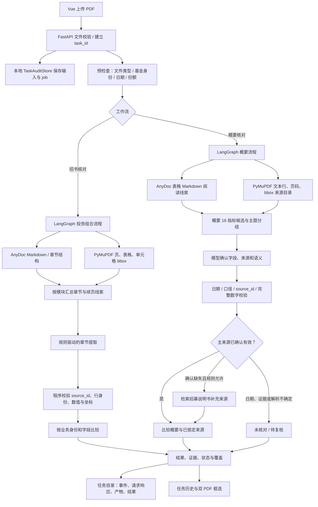

# 基金披露文件核对系统：当前 Python 设计与技术路线评审稿

- 文档用途：交给 Claude 对当前架构、技术选型、风险和演进路线做独立评审。
- 依据：仓库当前源码、规则文件、README 和实施计划；不是目标架构或已完成验收报告。
- 核对日期：2026-11-06。
- 当前分支：`11-06`。
- 敏感配置：本文不包含密钥；模型服务地址只记录本机 host/port。

## 1. 请 Claude 重点评审什么

请把自己当作金融披露文件处理、PDF 文档理解、信息抽取和生产系统架构评审专家，独立判断下面设计是否合理。不要默认现有做法正确，也不要把实施计划中的目标当成已经实现的功能。

请重点回答：

1. AnyDoc、PyMuPDF 与 LLM 的职责边界是否合适？目前把章节识别、表格抽取、语义理解和证据定位串在一起的方式有哪些准确率或稳定性风险？
2. 两条业务工作流应共享到什么程度？是否应先建统一 Document/Section/LogicalTable/Row/Cell/Source 中间表示，再分别做指标提取和核对？
3. “先按章节归集，再按章节/指标规则理解”与“直接按指标找全篇候选”的边界应如何设计？当前实现是否存在把没有关键词命中的内容判成未披露的风险？
4. 表格跨页、重复表头、无表头续页、行列换行、合计续页与段落跨页，推荐用什么通用方法识别和保留原始 PDF 坐标？哪些场景必须拒绝自动拼接？
5. 当前产品概要来源策略是否正确：定期报告是主依据；只有明确确认主报告未披露且规则允许时才从招募说明书补充；每个指标最终只使用一个来源。请检查日期、份额、期间、单位、费用性质的约束。
6. 任务 ID、产物留痕、缓存、重试和进程隔离是否足以支持测试阶段追溯？哪些信息该持久化，哪些不应保存？
7. 请给出按优先级排序的改进建议：短期可落地的修复、需要统一数据契约的重构、值得验证的解析器/模型替代方案，以及明确不建议做的改动。
8. 建议可量化的验收集和指标。请区分业务结论正确率、来源选择、识别覆盖、PDF 框选准确度、重复稳定性、运行成功率和性能；不要用模型自评或多数投票代替原文真值。

建议输出：总体评价、主要风险（按严重度）、目标架构图、阶段性迁移路线、关键验证实验、仍需业务确认的问题。请明确标注哪些结论依赖假设。

## 2. 产品目标与业务范围

本系统核对基金公开披露 PDF。当前有两种输入关系：

| 工作流 | 被核对文档 | 主要依据 | 可能的补充依据 |
| --- | --- | --- | --- |
| 招募说明书投资组合核对 | 招募说明书 | 操作人员选定的定期报告 | 无 |
| 产品资料概要核对 | 产品资料概要 | 概要编制时已经披露、且口径适用的定期报告 | 仅在规则允许且定期报告确认未披露/不适用时使用招募说明书 |

产品概要任务虽然允许上传概要、定期报告和招募说明书三个 PDF，但不是三份文件互相做全量比较。每个指标先核对“概要 vs 定期报告”；只有允许补充的指标在主报告确认缺失后，才核对“概要 vs 招募说明书”。一个指标的最终结论只选一个参考来源。定期报告已经找到有效证据时，即使内容与概要不同，也不能切换到恰好匹配的招募说明书。

当前业务覆盖：

- 投资组合流程：资产组合、按行业分类的股票投资组合、股票投资明细三个模块。
- 产品概要流程：Excel 规则中定义的 16 项指标，包括基金身份、管理人/托管人、合同日期、经理、投资信息、风险收益和费用等。
- 多产品评估语料目录包含华夏成长、华泰柏瑞沪深300、博时信用债券、国泰纳斯达克100ETF、天弘余额宝五只基金，共 25 份官方 PDF。语料齐备不代表每项测试预期都已独立核验。

当前不承诺支持任意基金文件或任意章节自动核对；QDII、货币基金、份额代码差异等是验证模型与规则边界的测试场景。

## 3. 当前技术栈

### Python 后端

- Python：`pyproject.toml` 声明 `>=3.10`，依赖由 `uv.lock` 锁定。
- Web/API：FastAPI、Uvicorn、`python-multipart`。
- 编排：LangGraph StateGraph；项目另有轻量 `WorkflowContext`、`WorkflowProtocol`、`WorkflowRegistry`、`WorkflowEngine` 适配层，便于与 AI 底座对接。
- LLM 接入：LangChain `ChatOpenAI`，走 OpenAI 兼容接口；环境也保留可选 OMP provider。
- PDF：PyMuPDF（`pymupdf`）用于文本、页、表格、单元格坐标、bbox 和原文核验；AnyDoc（`firecrawl-anydoc==0.2.4`）用于 Markdown/表格结构及章节阅读线索。
- 存储：任务元数据、输入 PDF、事件和产物存本地文件系统 JSON/JSONL；未引入关系数据库或对象存储。
- 并发：模型请求用 asyncio 并发上限；PyMuPDF/AnyDoc 的解析通过 spawn 进程池 `app/pdf_worker.py` 隔离，避免在同一进程用线程并发调用 PyMuPDF。

### 前端

- Vue 2.5、Element UI 2.12、Vue Router 3、Webpack 4。
- 前端独立于 AI 底座，实现任务列表、上传、历史任务详情、双 PDF 预览和证据框选。
- 当前结果接口兼容不同 `workflow_id`，核心工作流结果均保留各自 schema。

### 当前实际模型配置

检查项目 `.env` 的非密钥字段得到：`PROSPECTUS_LLM_PROVIDER` 解析为 `langchain`，`LLM_MODEL=gpt-6-luna`，`LLM_BASE_URL` 指向本机 `127.0.0.1:58815/v1`。API key 已配置但本文不包含其内容。这是本地配置快照，不代表文档所有处理步骤都由该模型执行，也不等于已经完成真实模型连通性或端到端验收。

## 4. 总体架构与数据流

这里的图表示两条当前实现路径及它们共同的文件/模型/追溯基础；**目前还没有完整实现一个统一的逻辑表中间表示或统一事实抽取服务**。`app/source_evidence.py` 已提供共享证据记录基础字段和稳定来源 ID，但各工作流的章节目录、表格模型、行身份绑定和比较逻辑仍有明显差异。

## 5. 组件职责

| 组件 | 当前职责 | 不负责什么 |
| --- | --- | --- |
| FastAPI (`app/main.py`) | 上传校验、任务创建/查询、PDF 图像端点、工作流注册与调用、错误映射 | 不直接判断金融语义或从 UI 坐标推断事实 |
| LangGraph (`app/runtime.py`) | 定义工作流节点、传递状态、发进度事件 | 当前概要图节点较粗；并非所有判断都拆成独立图节点 |
| AnyDoc | 生成 Markdown 表格/章节阅读线索，辅助理解跨页和复杂排版 | 不作为物理页码、精确文本、source_id 或 bbox 的权威来源 |
| PyMuPDF | 物理 PDF 文本、页面尺寸、表格网格/单元格坐标、原文引用核验 | 当前不含 OCR；扫描件不保证可读 |
| LangChain ChatOpenAI | 将候选原文、规则和结构提示交给 `gpt-6-luna`，返回业务行/字段和语义判断 | 不直接提供可信坐标；模型返回值须经程序验证 |
| 规则文件 | 描述目标指标、字段口径、来源与提取/比较约束 | 不能代替通用版面解析或自动证明字段不存在 |
| `TaskAuditStore` | 保存 task_id、原始输入、job 状态、事件、运行配置和产物 | 不是共享数据库；当前也不实现跨进程任务队列/自动续跑 |
| Vue/PDF Viewer | 任务操作、历史查看、结果展示、页码跳转和证据 bbox | 不自行修改核对结论 |

## 6. 工作流 A：定期报告核对招募说明书

主代码：`app/runtime.py` 的 `InvestmentComparisonWorkflow`，抽取位于 `app/extraction.py`，逐字段比较位于 `app/comparison.py`。

1. FastAPI 接收招募说明书和定期报告两个 PDF，检查扩展名、PDF 头、大小，并产生一个 task/run ID。
2. `preflight_documents` 用 PyMuPDF 提取封面/前页文本，识别文件类型、基金名称、代码、披露日期、报告期末和定期报告送出日期；身份不匹配或时点不适用时阻断或标记待核。
3. 对两份文档并行运行分析。投资组合分析流程先用 PyMuPDF 建页和页面文本，再调用 AnyDoc 生成 Markdown，按规则标题关联章节并收集物理页。
4. PyMuPDF 在候选页抽取表格和单元格 bbox；规则头字段映射到表格列。可建立完整列映射的表格，由程序形成 source row 目录，模型只选择行身份、业务分类和范围；字段值、单位、页和坐标从原表取回。未能完整建立源表映射时走模型文本提取与原文引用验证路径。
5. 跨页当前依赖 AnyDoc 章节 Markdown、物理页定位、表格列边界和已确认列映射等证据；续页缺表头时，在匹配规则和容差条件满足的场景中继承字段映射。无法证明时保留结构/证据复核，不根据行号直接配对。
6. 每个章节独立提交模型；对错误 JSON、遗漏/重复/伪造来源 ID、源表行覆盖不全或原文不支持的字段，最多局部重试一次。已成功章节可单独缓存；最终再做程序级字段与证据验证。
7. `compare_documents` 对基金代码、报告时点和各模块状态进行业务检查。按资产项目/行业/股票代码等业务身份对齐，不把行号变化本身作为数据差异；金额、比例、横线等按规则比较。
8. 结果含模块、行、字段、原文引用、source_ref、bbox 和待复核状态，前端据此跳转双侧 PDF。

当前限制：AnyDoc 解析失败在投资组合 `analyze_document` 中会使该文档分析失败；这条流程并未在所有异常下静默回退到 PyMuPDF。自动选取“招书披露日前最近一次公告”的外部公告检索也未接入，报告由操作者上传/选择。

## 7. 工作流 B：定期报告主核对产品资料概要，招书按需补充

主代码：`ProductSummaryVerificationWorkflow`、`app/summary_check.py`、`rules/product_summary/product_summary_v2.json`。

1. 任务必需文件是产品资料概要和定期报告，招募说明书可选。FastAPI 将角色明确为 `product_summary`、`periodic_report`、`prospectus`，禁止其他角色。
2. `preflight_summary_documents` 检查文档身份、基金代码/份额及日期。概要以编制日为目标时点；定期报告需能证明送出日期不晚于概要编制日。日期缺失、范围重叠或报告较晚时，主来源不得用于该概要的历史核验，也不能借全文查找旁路重新引入。
3. `build_document_source_catalogue` 对每个 PDF 建立 PyMuPDF 文本行 source；AnyDoc 可用时添加 Markdown 阅读上下文。文本来源保留 PDF 原文、页码、bbox 和来源 ID；AnyDoc Markdown 只提供表格结构线索，不作为引用。
4. 对 Excel 中的 16 项指标，根据指标词、标题提示和完整章节上下文生成概要、主报告、可选招书候选。相比早期固定前后行数，目前概要候选按章节结构向后收集到同级/上级标题；识别不到章节标题时以完整匹配页为边界。
5. 模型按主题分组分析候选，必须返回规则 item ID、概要值/来源 ID、定期报告值/来源 ID、状态和理由。程序验证引用 ID 是否来自允许候选、字段标签和值能否被引用原文证明、数字是否完整匹配，短代码/姓名不因长度短而拒绝。
6. 规则把指标含义、值类型、期间、单位、比较策略和来源优先级传入模型。日期/主来源适用性和补充来源资格由程序再约束。自动数值相等判定仅对规则明确的年费率启用；年度实际金额、不同费用性质或期间不明时保留模型语义结果或未决状态。
7. 只有主报告被完整查找后明确确认未披露，且指标规则允许补充，才调用招募说明书局部查询。主来源有有效证据就锁定主来源；不是“选三份里最像目标的文件”。
8. 最终结果为 16 项的状态、主/补充来源查询状态、选定来源、两侧证据、reason_code 和覆盖统计；现在附加区分 `extraction_status`、`applicability_status`、`comparison_status`、`evidence_status` 的字段，旧 `status` 仍保留以兼容界面。

当前限制：概要图现在有 `load_documents → index_sources → compare` 三个粗节点，主来源候选检索、全文确认、补充来源、比较和引用校验主要仍在 `compare_product_summary` 一处编排；还没有把已验证事实保存成独立可复用对象，也没有完整实现按节点断点恢复。AnyDoc 失败时概要目录保留 PyMuPDF 并记录失败状态。

### 当前概要 16 项与规则性质

基金简称、基金代码、管理人、托管人、合同生效日、基金经理、经理任职日期、场内简称/扩位简称、投资目标、投资策略、业绩基准、风险收益特征、管理费率、托管费率、审计费用、信息披露费用。

全部指标的主来源配置为定期报告；管理人、托管人、管理费率、托管费率、审计费用和信息披露费用可按规则从招募说明书补充，其中审计费/披露费的定期报告适用类型为年度报告。此表述来自当前 JSON 规则配置；逐指标的期间、单位和当前配置应以对应规则行核实。

## 8. 模型与确定性代码边界

当前使用模型做的工作：

- 在有限的章节/来源候选中识别业务对象、行身份、章节语义和字段含义。
- 对文字条款、基金管理人/托管人等语义文本判断是否对应。
- 在候选中选择 source_id 并给出有限结构化 JSON。

当前由程序承担的约束：

- PDF 文件格式、页数/大小、章节候选、物理页、bbox 和原文是否存在。
- 输入文件角色、基金身份/时点适用性、来源顺序和允许的补充条件。
- 模型不能自创来源 ID；数字必须能由被引用原文完整证明，禁止子串误证。
- 对有明确类型/单位/期间规则的年费率按数值规范化比较；未知语义或不确定引用不强行给结论。
- 结果状态、覆盖计数、任务留痕和重复/缺失来源校验。

这不是“把 PDF 原文件无约束地扔给一个通用模型让它自行判断”。目前是 parser-first 的候选证据检索 + 有约束的 LLM 结构化判断 + 程序二次验证。其收益是输出能回指真实 PDF；代价是章节候选、表格归属和来源规则如果先丢失上下文，模型无法恢复从未提供的证据。

## 9. 规则与跨页策略

- 投资组合规则为 Markdown，定义章节意图、字段列别名、业务身份和比较语义；公共规则定义共享证据/数值处理要求。
- 概要规则是 JSON（有对应逐项 Markdown 文件作为规则材料），包含 item key/label、候选词、主来源、补充来源条件、业务含义、value type、period/unit/comparison policy。
- 不能把特定产品名、具体金额、固定页数/页码、固定行号写成生产分支条件。
- 跨页表格的当前实现属于“章节级上下文 + 每页 PDF 原表 + 表头/列映射 + 续表兼容性证据”的混合策略，不是对任意 PDF 的通用版面模型，也没有证明所有表格已稳定拼成统一 logical table。
- 对某一页出现新表头、无表头、列边界变化、合计单独一页等情况，只有证据充分才可沿用映射；未知时应待复核，不因为数值相同就忽略结构问题。

## 10. 任务、追溯、缓存与安全

- 后台上传创建唯一 `job_id/run_id`；两类工作流使用同一任务查询与追踪 API，便于按 ID 查看历史。
- `TaskAuditStore` 保存原始 PDF、元数据/SHA-256、job 状态、阶段事件、运行配置和每个 trace artifact。任务目录/文件权限设为用户可读/写，事件使用 JSONL，产物原子写入。
- 留痕内容可能含 PDF 全文、完整模型输入提示词和原始响应；当前是本机文件存储，目录不能视为已完成多租户隔离或企业数据治理。
- 服务重启时把未结束任务记为 interrupted/failed；保留历史，但尚未从 checkpoint 自动续跑同一个 task ID。
- 投资组合章节缓存按文件哈希、角色、规则、模型/提示词和实现版本等隔离；重用已验证章节时仍重新校验当前来源。概要流程目前无同等的可复用事实缓存。
- 模型并发、PDF 解析 worker、最大文件大小、页数和超时从环境配置读取。不要将 `.env` 密钥写入评审文档、日志摘要或 Claude 提示词。

## 11. HTTP 接口与前端路径

常用接口：

- `POST /api/jobs`：招募说明书 + 定期报告后台核对。
- `POST /api/product-summary/jobs`：概要 + 定期报告；招募说明书为可选补充。
- `GET /api/jobs/{job_id}`、`GET /api/tasks`：任务状态、结果、历史查询。
- `GET /api/jobs/{job_id}/trace` 与 `/artifacts/{path}`：读取追踪事件和具体产物。
- `GET /api/jobs/{job_id}/documents/{role}/pages/{page}/image`：任务留存 PDF 页图供双栏 viewer 使用。
- `GET /v1/workflows` 与 `/v1/workflows/{workflow_id}/runs`：通用 workflow 接口。

页面主要文件：`frontend/src/views/TaskList.vue`、`Workbench.vue`、`ProductSummaryWorkbench.vue`、`components/PdfViewer.vue`、`components/UploadDialog.vue`。任务页和证据卡片读取后端 source evidence 的角色、页码和 bbox；内容识别成功与 bbox 精确定位状态应区分处理。

## 12. 当前优势、主要风险及已知缺口

### 设计上希望保留的特点

- 使用实际 PDF 来源而非模型自由生成的数值作为结论依据。
- 业务行按代码/名称/指标身份对齐，不把序号、行号变化直接判作差异。
- 主报告和可选招书补充来源有明确优先顺序；未命中不自动等同于未披露。
- 文本/表格抽取和坐标定位分开；证据失败应能单独呈现。
- 任务 ID、原始输入、模型调用和处理过程留痕，便于复现和定位问题。

### 评审时应挑战的风险

1. AnyDoc、PyMuPDF 两种表示按章节/页/表格线索关联，错误关联会导致模型在错误候选上“正确回答”。
2. 当前共享 source evidence 仅统一记录底层字段；两个工作流仍用不同的章节和表格结构，跨工作流复用度有限。
3. 概要主来源全文查找和补充查找仍集中于一个长函数；局部错误可能改变来源选择或多个状态，难以独立重跑。
4. 规则词语召回依赖术语和章节线索；词法候选为空时，对“确实未披露”必须保持谨慎，但全文/章节扫描的完整性仍需实测。
5. 只靠文档首几页和文本标签识别日期/身份，可能受封面变体、份额、PDF 文本层质量影响。
6. 当前没有 OCR；扫描件将无法完成基于原文层的确认。AnyDoc 未必替代 OCR 或坐标定位。
7. 本地 JSON 审计适合单机测试，不等于生产任务队列、权限隔离、容量管理、并发锁、备份与保留周期方案。
8. 旧 UI 和不同 schema 兼容、稳定 ID 跨版本策略、cache invalidation 与任务产物体积需要继续验证。

这些是评审问题/风险方向，不全都已在生产中复现。应要求 Claude 区分源码事实、工程推断和需要实验才能确认的判断。

## 13. 验收现状与非目标

- 当前代码有自动化回归测试；最近完整测试记录为 59 项通过，但其后仍有局部源码改动，最终文档交付时应重新运行测试。
- `evaluation/cases/manifest.json` 固定了五产品的 15 个基础任务配对，输入 SHA 校验可执行。
- 当前预期文件仍有待逐项独立 PDF 核验的项目；旧版本真实模型基线未完整建立。
- 完整实施计划要求冻结版本后做 15 案例 × 3 次非模型缓存运行，再做 15 次缓存对照，并保留 task_id、trace、结果、定位和耗时。当前尚未完成这些运行，因此不能声明五产品准确率、稳定性或性能目标通过。
- 不属于本次文档表达的既成事实：自动接入证监会公告抓取、通用 OCR、任意文件类型识别、数据库持久化、多租户用户体系、任务 checkpoint 恢复、任意章节知识库核验。

相关计划：[`2026-11-06-统一文档核对优化与多产品反复测试实施计划.md`](../plans/2026-11-06-统一文档核对优化与多产品反复测试实施计划.md)。该计划的“目标架构”章节是后续方向，不能与本文第 4–7 节的当前实现混为一谈。

## 14. 关键源码入口

| 主题 | 路径 |
| --- | --- |
| API、任务创建与模型配置加载 | `app/main.py` |
| 模型 provider | `app/ai.py` |
| LangGraph 与两条 workflow | `app/runtime.py` |
| 投资组合章节抽取、表格行列、定位验证 | `app/extraction.py` |
| 投资组合业务身份匹配与比较 | `app/comparison.py` |
| 概要来源目录、日期资格、主/补充查找与比较 | `app/summary_check.py` |
| 文件身份/时点预检 | `app/preflight.py` |
| 本地 task_id 审计/产物存储 | `app/audit.py` |
| PDF 解析进程池 | `app/pdf_worker.py` |
| 概要 16 项规则 | `rules/product_summary/product_summary_v2.json` |
| 三个投资组合模块规则 | `rules/investment/` |
| 五产品固定输入语料 | `assets/corpus_manifest.json`、各产品 `manifest.json` |

