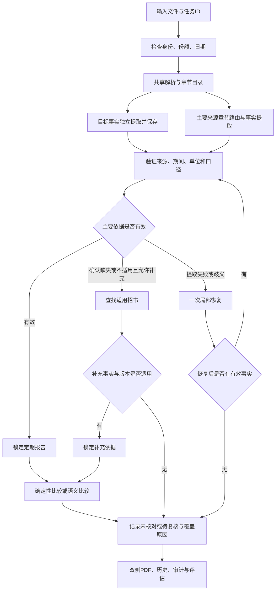

# 统一文档核对优化与多产品反复测试实施计划

- 日期：2026-11-06
- 状态：用户已恢复实施；R0留痕及R1 Markdown规则/稳定ID首轮落地；R2–R5仍有未完成项，R6未完成。跨产品最终验收尚未完成。
- 修订说明：2026-11-06 新增第 13–15 节，调整恢复后的实施顺序；与前文执行顺序或旧进展描述冲突时，以这三节为准。原业务范围及多产品验收要求保留。
- 当前分支：11-06。执行前重新确认仓库、分支和未提交改动，保护已有工作。
- 目标：修复确定性误判，统一两种任务的文档与证据能力，再使用不同产品反复验证准确性、稳定性、框选和耗时。
- 前置方案：[定期报告主校验与概要补充来源实施计划](2026-11-06-定期报告主校验与概要补充来源实施计划.md)。文件角色和来源优先级沿用前置方案；本计划细化实现修正与验收方法。
- 语料入口：[官方语料说明](../../assets/README_官方语料.md)、[下载清单](../../assets/corpus_manifest.json)。当前为 5 个产品、25 份 PDF，每份保存官方来源、披露日期及 SHA-256。

## 1. 核心需求与边界

| 任务 | 被校验文件 | 主要依据 | 补充依据 |
| --- | --- | --- | --- |
| 招募说明书核对 | 招募说明书 | 对应章节数据截止日适用的定期报告 | 无 |
| 产品资料概要核对 | 产品资料概要 | 编制时点已披露且对指标适用的定期报告 | 招募说明书，仅规则允许的指标 |

概要任务可上传三份文件，但每项结论只选择一份参考来源。主要报告已有适用内容时，保留其一致或差异结论，不因差异改选招书。

本期先覆盖原有三个投资组合模块及概要 Excel 的 16 项指标。QDII、货币基金等出现不同结构时，验证适配与拒绝能力；不擅自扩大成所有章节、所有金融指标均支持。

业务规则只描述指标含义、来源、期间、单位及比较方式。产品名、具体数值、固定页码和行号不得成为生产判断条件。布局、跨页和坐标关系由共享解析层处理。数值规范化和来源校验属于必要的通用程序能力。

本计划不包含部署、提交或推送代码；实施时不自动更换模型、连接地址或账号。

## 2. 执行原则

1. 先修复能稳定复现的程序错误，再评价模型质量。
2. 测试预期来自 PDF 原文及独立核验，不以当前模型输出或多次投票作为标准答案。
3. 先检查身份、份额、期间和口径，再选择来源、比较内容。
4. 提取失败、候选未命中、引用失败都不等于未披露。
5. 双方确认无相关内容才可跳过；目标有内容而缺少依据须记录未核对原因。
6. 内容判断与定位精度分开，定位失败不能清空已经确认的业务值。
7. 每个真实运行创建新任务 ID，记录完整输入、输出、规则和决策产物，不覆盖旧任务。
8. 局部恢复最多一次；保留已验证成功部分，不循环重跑整个任务。

## 3. 当前已知问题与修正要求

| 问题 | 修正要求 | 必须覆盖的例子 |
| --- | --- | --- |
| 数字开头的普通内容被当成标题 | 综合编号格式、版面、字体和上下文确认标题，代码/日期/金额不自动入章 | 510100、2019-09-06、金额与比例 |
| 证据按字符串长度判断有效性 | 校验字段身份、真实值和来源关系，取消长度大于四字的业务判断 | 基金代码+510100；基金经理+余海燕 |
| 数字只做子串检查 | 按完整数字 token、正负号、单位、比例及日期检查，禁止部分命中 | 10 不得由 510100 证明 |
| 标签和值拆开即被拒绝 | 允许多段原始来源共同证明同一个事实 | 竖排姓名、换行日期、横排标签值 |
| 固定行数和相邻一页限制 | 按章节及逻辑表边界归集，长内容按业务单元拆包 | 三页以上续表、跨页条款、合计 |
| 规则字段只写入 JSON 未实际执行 | 把含义、期间、单位、比较策略传入模型契约，并在程序中执行适用性约束 | 年费率、年度实际金额、预估费用 |
| 数字比较覆盖口径未确认状态 | 仅在双方事实适用且口径确认后执行数字比较 | 相同数字但费用性质/年度不同 |
| 概要流程用线程并发调用 PyMuPDF | 复用已有 PDF 进程隔离能力；模型请求可受限并发 | 多文件解析、并发任务 |
| 模型反复提取同一事实 | 已验证事实复用，恢复只针对失败原因和局部来源 | 已成功字段不随其他项重试变化 |

不得通过删除指标、放宽引用到整页、静默跳过错误或增加“一致”默认值来提高统计成绩。

## 4. 目标架构

没有选定有效依据的项直接形成未核对/待复核记录，不进入比较模型。恢复结果重新进入适用性校验，不可绕过主来源优先级。

### 4.1 共享来源目录

统一表达 Document → Section → Paragraph / LogicalTable → Row / Cell → Source。

- 文档：哈希、实际类型、基金身份与份额、所有日期、解析版本及来源。
- 章节：标题证据、层级、起止来源、覆盖物理页；正文与数字不得污染章节层级。
- 表格：逻辑表 ID、物理片段、表头、单位、业务行、单元格、跨页关系、合计与脚注。
- 来源：原始文字、物理页、页尺寸、旋转、bbox 和稳定 source_id。
- 合并文本只作为阅读线索，保留全部原始来源 ID 与独立坐标。

复用 AnyDoc 的章节/阅读线索与 PyMuPDF 的文字、表格及坐标能力，抽出两种任务都能调用的接口。解析器冲突时记录冲突，局部复核；不要求所有 PDF 同时通过所有解析器，也不把任一解析器视为真值。

普通段落按条款延续；跨页表综合章节、列语义、布局及续表线索建立关联。新表头不意味着必然换表，缺表头也不意味着必然续表。

### 4.2 事实、来源与比较契约

每项事实至少包含：对象、指标、原文值、规范值、类型、单位、份额/市场范围、期间、费用性质或条款适用日期、source_ids、提取状态和证据状态。

表格来源能确认时，模型选择业务行/单元格 ID，程序从来源目录取回原始值与坐标，减少模型重新抄写数值。文字条款由模型理解，但必须返回原文依据。

每项规则至少包含：key、业务含义、来源优先级、补充条件、期间要求、类型/单位、比较方式。各字段必须有实际消费位置，防止只保存规则版本却未执行规则。

来源状态明确区分 FOUND、CONFIRMED_ABSENT、NOT_APPLICABLE、EXTRACTION_FAILED、AMBIGUOUS。确认缺失须保存检查的完整相关章节范围及依据；词法未命中不能作为确认缺失的证据。

比较前锁定来源。代码、金额、费率和日期在身份及口径确认后由程序比较，保留前导零及精度规则；文本条款由模型比较，保留否定、限制和生效条件。

### 4.3 结果、图编排和追溯

分别保存 extraction_status、applicability_status、comparison_status、evidence_status，并提供结构化 reason_code。用户界面保持“一致、差异、待复核、未核对”等简洁表达，详情能解释具体原因。

LangGraph 按职责拆为：输入检查 → 共享解析 → 事实提取 → 主来源适用性 → 补充来源选择 → 比较 → 证据/覆盖校验 → 持久化。共享事实与来源契约，避免两个流程各自实现校验。是否支持断点恢复必须以持久化能力为准，不能把保存任务历史当作已经支持恢复。

缓存键包含输入文件哈希、解析器/实现版本、规则/提示词哈希、模型与参数。保存已验证来源与事实，缓存命中后仍检查文件和引用归属。旧任务保持其原始 schema，不能升级规则后直接重写旧结论。

## 5. 实施阶段与退出条件

| 阶段 | 主要改动位置 | 工作与退出条件 |
| --- | --- | --- |
| P0 固定基线 | assets 清单、tests、评估工具 | 检查25份文件及哈希，冻结配对；从PDF建立预期清单；记录旧代码和模型配置 |
| P1 修正确定性错误 | app/summary_check.py、相关测试 | 短文本、数字、标题、拆分引用、完整数字匹配通过；正确值通过且错误归属仍被拒绝 |
| P2 来源与口径执行 | 概要规则、预检、来源选择与比较模块 | 规则实际进入执行；期间/费用性质不确定不作数值结论；主报告差异不被补充文件覆盖 |
| P3 共享文档基础 | app/extraction.py、app/chapter_sources.py、建议共享来源模块 | 两任务复用章节、表格和坐标；无固定页数截断；PDF解析隔离到进程 |
| P4 事实与流程拆分 | app/runtime.py、事实/比较/证据模块、app/audit.py | 已验证事实可复用，失败可按阶段定位；各类状态独立，完整覆盖可追溯 |
| P5 展示与兼容 | 概要结果页、PdfViewer、任务列表与上传界面 | 一致项和差异项均可定位；选补充项正确切换右侧；旧任务可读 |
| P6 多产品反复验收 | 评估脚本、评估样本、结果报告 | 按第7至10节执行，固定版本完成重复运行，记录通过与未解决项 |

建议新增模块名称可按仓库约定调整，不为了达到文件数量拆分。每阶段先运行受影响检查；共享解析改动后补跑投资组合回归。

暂停复核后，P0–P6 作为交付范围保留；恢复执行按第 14 节 R0–R6 的依赖顺序推进。优先完成规则与事实契约、章节路由及目标事实复用，再修复局部引用问题，不沿旧函数继续叠加指标特判。

## 6. 五个产品的固定测试配对

文件名、官方地址和哈希以各产品 `manifest.json` 为准。下表只是初始配对，P0必须逐项复核，不等于所有字段已具备一致预期。

| 产品/代码 | 招书版本 → 投资组合依据 | 概要版本 → 主要依据 | 年度费用样本 | 重点 |
| --- | --- | --- | --- | --- |
| 华夏成长 / 000001 | 2026-07-27 → 2026年第1季度报告 | 2026-07-27 A份额 → 2026年第2季度报告 | 2025年报 | 招书财务截止3月；基准7月27日变更；A/B及前后端代码 |
| 华泰柏瑞沪深300ETF / 510300 | 2025-11-24 → 2025年中期报告 | 2025-11-24 → 2025年第3季度报告 | 2024年报 | 11月招书财务仍截止6月；指数/积极投资分别识别 |
| 博时信用债券 / 050011 | 2026-09-21 → 2025年中期报告 | 2026-09-21 A/B份额 → 2026年中期报告 | 2025年报 | 招书财务滞后一年；股票与债券；主代码和份额代码 |
| 国泰纳斯达克100ETF / 513100 | 2026-09-15 → 2026年第2季度报告 | 2026-09-15 → 2026年中期报告 | 2025年报 | QDII、GICS、境外机构、国家地区、币种 |
| 天弘余额宝 / 000198 | 2025-10-21 → 2025年中期报告 | 2026-06-26 → 2026年第1季度报告 | 2025年报 | 股票模块不适用；概要用此前招书补充；货币基金结构 |

注意：

- 天弘招书原文引用2025年第2季度报告，包内现为同截止日中期报告。必须逐模块确认可比性；不能把同截止日当作完全等价。若验收必须使用原引用报告，先从官方补齐并更新清单和哈希。
- 同批概要编制日可能早于招书公告日，逐条确认生效依据；无法确认时记录待复核或使用适用旧版本，不强行认定可作补充。
- 年报是单独的定期报告测试输入。年度费用适用性测试可用概要+年报另建任务；不能把季度/中期报告和年报作为两个同时生效的主要来源塞进一个任务。
- 估计年费用、合同费率与年度实际费用不自动等价；年报存在不代表所有费用均可比较。
- 基准变更、缺失指标和不适用模块可能有合理的非MATCH结果，不能为了通过而改成一致。

## 7. 建立可核验的预期结果

建议新增 `evaluation/cases/`、`evaluation/expected/` 和 `evaluation/derived/`；正式语料留在 assets，不覆盖、不修改原始官方PDF。

每个案例固定 case_id、任务类型、文件角色和哈希、目标章节/指标、适用期间、预期来源、预期值/业务结论、原文页码、原文或单元格引用、核验方法和核验状态。

投资组合基线覆盖所有适用业务行、合计及数值列；概要基线列出全部16项，对每项注明存在、缺少依据、不适用或有待确认。不能只标模型已经找到的项。

AI可以辅助整理预期，但须通过独立路径与PDF原文逐项核验：结构化提取与原页核验相互对照，关键数值做完整集合核对，必要时保留页面或表格截图。第二次同模型输出及多模型多数票均不能直接作为真值。无法确认的项记为 `EXPECTED_UNCONFIRMED`，排除出准确率分母并单独列出；不得借此宣称完整验收通过。最终业务歧义供用户复核，其他工作继续。

开发调试先使用华夏成长、华泰柏瑞ETF、博时信用债券；国泰QDII和天弘货币作为首轮独立产品验收。在开发阶段不按这两个产品的具体名称/数值编写分支。若独立验收失败，归纳通用原因修正，再重新验证全部五产品，保留第一次独立验收结果。

## 8. 反复测试矩阵与执行方法

### 8.1 每个产品的基础案例

| 编号后缀 | 输入 | 验收目的 |
| --- | --- | --- |
| PROSPECTUS | 招书+招书对应报告 | 章节、完整逻辑表、行身份、数值、合计与框选 |
| SUMMARY_PRIMARY | 概要+主要报告，不传招书 | 主来源覆盖；缺少补充不导致整个任务失败 |
| SUMMARY_FALLBACK | 概要+主要报告+允许的补充招书 | 每项来源唯一、补充有依据且不覆盖主要差异 |

五产品共15个基础案例。规则或产品不适用的项目有明确预期，不以模块数量相同作为验收条件。

### 8.2 重复运行

1. P0对10个核心组合（五产品×两种任务）各运行一次旧版本基线；若环境阻塞，记录原因，不编造基线。
2. 开发中只复跑受影响的产品与局部场景，避免每次小改动都发起全部真实模型任务。
3. 优化完成并冻结代码、规则、模型与提示词后，对15个基础案例各执行3次，均绕过模型结果缓存，共45次真实任务。
4. 45次按产品交错运行，并包含一次服务重启后运行，避免只观察连续同文件调用；每次新建任务ID。解析缓存是否开启单独记录，不能混同于模型结果缓存。
5. 同一版本对15个案例各补一次缓存运行，验证结果等价与耗时，共15次；首次解析、解析缓存、事实缓存、模型缓存命中分别记录。
6. 增加概要+年报费用口径案例，仅对可确认预期的产品执行；语义或期间不明确时验收正确的拒绝/未核对行为。
7. 最终验收期间若修改影响结果的代码、规则或提示词，重置版本并重新执行该版本的完整三轮；不能把多个版本中最好的一次拼成通过结果。

未配置、超时或服务失败算运行失败并保留记录。恢复后以新的任务ID补跑，原失败不得从统计中删除。批次必须有请求、排队和总执行超时，禁用无限重试。

### 8.3 必须有的错误与边界案例

优先用真实文档；确需构造时在 `evaluation/derived/` 创建明确标记的派生PDF或结构化夹具，并记录父文件哈希及修改内容。纯比较逻辑可用局部夹具验证，无须为每个边界都调用完整模型。

| 场景 | 预期行为 |
| --- | --- |
| 正确短姓名、代码、拆分日期、金额横线 | 不因长度、数字开头或断行被拒绝 |
| 数字子串、错误列、同值不同字段 | 拒绝错误引用或归属，不判一致 |
| 表格跨多页、重复表头、无表头、合计单独续页 | 完整归集，保留原页坐标，未确认续表不强拼 |
| 行顺序变化、行号变化 | 按业务身份配对；是否比较排名按指标规则处理 |
| 负号、千分位、百分比、元/万元、空值标记 | 按明确类型/单位规则比较，未知口径保留疑点 |
| 报告有差异、招书恰好相同 | 仍选择报告并保留差异 |
| 报告关键词未命中、解析失败、模型漏项 | 局部恢复，不能直接认定未披露并补充 |
| 报告确认缺失，允许补充且招书适用 | 选招书正常比较，记录选源原因 |
| 同数字不同年度/费用性质；条款生效日期不明 | 不强制数字结论 |
| 不同产品、不同份额、报告披露晚于适用时点 | 正确区分拒绝、份额映射与不适用，不静默混比 |
| 双方确认无内容；仅目标有内容 | 分别为跳过和未核对，保留覆盖依据 |
| 模型无效JSON、超时、伪造source_id | 一次局部恢复后明确失败/待复核，成功项不丢失 |
| 内容确认但精确框选失败 | 保留业务事实，定位状态单独显示 |
| 旧任务、缓存失效、服务重启 | 历史可读，版本变更不误命中，不伪造任务恢复 |

不同产品交叉错配至少覆盖两组，另外覆盖主代码与份额代码不同但仍属同一基金的合法情况。

## 9. 每次运行的记录与指标

记录到任务审计目录，另由评估工具聚合到 `var/evaluations/<batch_id>/`。建议包含 batch_manifest.json、expected_snapshot.json、runs.jsonl、metrics.json、failures.md 和报告；具体文件名可按项目约定调整。

每次至少记录：

- case_id、batch_id、task_id、代码提交及工作树差异摘要/哈希。
- 输入PDF哈希、份额、报告期间、披露/编制/生效日期依据。
- 解析器版本、规则与完整提示词哈希、模型实际名称及请求参数；请求和原始响应可追溯，不保存密钥或私有思维链。
- 原始解析、章节覆盖、表格片段关系、业务事实、主/补充查找、选源、引用验证和最终覆盖清单。
- 提取、选源、比较、定位各自结果及reason_code；恢复次数和失败类别。
- 解析、排队、模型请求、校验、渲染及总耗时；请求次数、token用量、结束原因和缓存命中。接口未提供用量时标明缺失，不估算成实测值。

统计采用全部预期对象作为分母，适用、缺失、不适用、预期待确认分别列出：

| 指标 | 计算与用途 |
| --- | --- |
| 识别覆盖率 | 正确识别的预期事实/全部适用且预期已确认事实；发现漏项 |
| 结论正确率 | 正确业务结果/全部预期已确认项目；未核对和待复核也须按预期评分 |
| 差异精确率/召回率 | 分别发现误报与漏报；没有真实差异时不填100%，另用已核验差异案例验收 |
| 来源选择正确率 | 正确文件、期间、份额和口径的选源/预期已确认选源项目 |
| 重复稳定性 | 三轮规范值、业务身份、选定来源、状态与覆盖是否一致；不要求理由措辞相同 |
| 定位正确率 | 已确认业务结论中，两侧页码及框选与原文对应的比例；页级回退单列 |
| 运行成功率 | 成功结束任务/全部发起任务，失败重跑仍保留失败分母 |
| 性能 | 按产品/任务/缓存分组报告中位数、最慢值和样本量；少样本不推导吞吐量或SLA |

## 10. 通过标准与停止条件

以下为本期验收目标，不是当前已达到的结果：

1. 第3节确定性错误与第8.3节关键拒绝场景全部通过；不存在已知的错误“一致”或错误覆盖主要来源。
2. 原有适用投资组合模块，基线业务行、合计和数值字段完整覆盖，预期已确认的数值及差异集合全部正确；不适用模块有证据且不被制造成差异。
3. 概要每份16项均有明确覆盖结果。预期已确认且可提取项目必须正确完成，不能以待复核掩盖已知可识别值；不适用/无依据按预期正确处理。
4. 五产品的15个基础案例三轮业务结果一致，真实差异及拒绝行为稳定；不同合法引用片段可接受，但必须指向相同事实且均可复核。
5. 每个适用且可定位的目标项目，两侧页码/框选经检查正确；无法精确定位的项明确列出且不得宣称精确定位通过。补充项右侧打开正确招书。
6. 所有任务具有可追溯产物；无有效比较时不显示整体一致；旧任务不被重写。
7. 提速在同一案例、同配置、相同覆盖和正确性前提下比较。目标是减少重复模型调用并使多数案例中位耗时不劣于基线；任何退化都说明阶段和原因，不预先承诺固定秒数。
8. 缓存运行与该版本非缓存业务结果等价，缓存键变更正确失效；不能用缓存稳定替代模型非缓存稳定性验收。

失败时先按解析、章节、字段归属、期间/口径、模型输出、引用校验、比较、展示分类，修正通用原因，补充最小必要回归，再按影响范围复跑。禁止为某个产品写具体名称/值/页码例外。

同一根因连续三轮修正后仍无进展，或原文无法确认、真实模型不可用时，记录具体阻塞、证据及已尝试方案；继续不受影响部分，不无限消耗模型调用。存在未满足标准的项目时，交付状态只能为“部分完成/待验收”，不得标为全部通过。

## 11. 最终交付与AI执行要求

最终交付包括：修复代码、共享来源/事实契约、轻量且实际生效的规则、必要回归、可重复执行的评估入口、固定案例与预期依据、全部任务ID及跨产品验收报告。

执行入口应支持指定案例、模型结果缓存开关、重复次数、输出批次目录和恢复评估清单。具体命令在工具实际存在并验证后写入README，不能提前提供不存在的可执行命令。

验收报告需逐产品列出：两种任务、使用文件、预期和实际覆盖、差异/待复核/未核对、补充来源、三轮稳定性、定位、调用次数及冷/缓存耗时。失败项附任务产物路径和下一步，不只给一个总准确率。

用户已恢复实施。按第14节顺序覆盖P0至P6全部要求，完成实现及反复测试，无需每阶段重复询问。不得擅自部署、推送、修改原始官方PDF或改变模型连接。

## 12. 实施进展

| 阶段 | 状态 | 记录 |
| --- | --- | --- |
| P0 固定基线 | 进行中 | 已逐份复核官方语料清单中的 25 份 PDF：哈希、字节数及页数全部匹配；已固定 5 产品的 15 个输入配对和预期文件。评估器现为 tracked/untracked 代码、规则和提示词建立工作树指纹，并在每个任务结果中记录输入文件 SHA-256；PDF语料、`.env`和运行产物不进入源代码指纹。专项测试3项通过。预期文件仍待独立原文核验。旧实现的 10 个模型基线尚未建立，不能用本次修复后的结果代替。 |
| P1 修正确定性错误 | 已完成首轮 | 修复完整数字 token 证明、短字段证据和章节标题误识别；新增数字子串、基金代码/经理短值、日期/代码标题测试。用原始易方达概要 PDF 验证 `基金代码 + 510100` 与 `基金经理 + 余海燕` 的证据均通过，`510100` 不再进入章节目录。全套现有测试 54 项通过。 |
| P2 来源与口径执行 | 进行中，需按修订方案调整 | 已将业务含义、值类型、期间、单位和比较策略放入模型字段契约；增加了年费率比较及代码集合交集策略。代码交集策略在暂停复核中被认定过宽，不能作为完成项；须按第13–14节区分基金关联和份额字段。年度实际金额的期间/性质、适用版本及来源锁定仍待完整验证。 |
| P3 共享文档基础 | 进行中 | 概要目录生成和独立调用入口已从 `asyncio.to_thread` 改用现有 `run_pdf` 进程池；概要候选改按结构标题收集完整跨页章节，无标题证据时取完整命中页，移除了固定页数/行数截断和费用章节页码特判。新增共享来源记录基础字段与稳定 ID，投资组合表格行和概要文本行都保留原文、物理页、bbox、文档角色；投资组合缓存版本纳入共享契约代码。章节/逻辑表统一目录及解析冲突处理仍未完成。 |
| P4 事实与流程拆分 | 进行中 | 概要结果新增提取、适用性、比较和证据四类状态字段，旧 `status` 保留供现有界面兼容。LangGraph 仍把查源、补充来源、比较与证据校验集中在比较函数中，缓存的事实复用和按阶段重跑尚未完成。 |
| P5 展示与兼容 | 未完成 | 当前只扩展了兼容字段，尚未逐项复核概要页面、补充来源右侧切换、历史任务读取及旧 schema。 |
| P6 多产品反复验收 | 未开始正式验收 | 已有一个产品的三次开发试跑，跨代码版本，详见第13节；不属于冻结版本的多产品重复验收，不能报告准确率或稳定性。 |

恢复实施记录（2026-11-06）：确认实际分支为 `11-06`；保护已有修改及未跟踪语料。R0 已补全源树SHA-256指纹和每个评估任务的输入哈希留痕。R1 新增 TOML front matter + Markdown 正文规则加载契约，稳定 `item_id`、`module_id` 分组接口及重复ID/缺失字段校验；原16项规则迁移和概要流程改用新契约仍在进行。专项验证：评估器和规则加载器测试6项通过；不代表集成或模型准确率验收。

本轮代码版本尚未冻结，15 个案例的预期结果未完成独立 PDF 核验，未发起 45 次真实模型任务；不得据本轮回归宣称跨产品准确率或稳定性通过。P3 的进程隔离、完整章节归集与共享来源记录基础现由全套 59 项测试覆盖，仍需针对多任务并发解析另做验证。

以上是各阶段当时的进展记录，不代表暂停时的最终代码版本全部通过。最新完整回归与专项回归的适用范围见下方复核记录；后续必须保存当前版本、任务ID与验收报告，历史“测试通过”不能替代当前版本验收。

## 13. 暂停后的问题复核与方案纠偏

完整复核：[概要核对当前效果与架构复核](../research/2026-11-06-概要核对当前效果与架构复核.md)。本次只读取已存在的任务产物和代码，没有新建模型任务或修改业务代码。

### 13.1 开发试跑的实际效果

| 任务 ID | 同一案例的开发试跑结果 | 观察耗时 |
| --- | --- | --- |
| `bOZoAe690CZ7gkXtgEE_yvoh` | 基金主代码与前后端代码混淆，预检拒绝 | 约2秒 |
| `QFlrz0Mrh0B23kjzkUkshCBF` | 7一致、5待复核、3未核对、1差异 | 76.191秒 |
| `iNPVUTOYWTViBZsAIrK0eBm_` | 8一致、5待复核、3未核对 | 68.165秒 |

文件相同但代码/规则/提示词不同，不能据此计算同版本稳定性或提速。最新一次经理任职日期和风险收益特征恢复，但基金经理变为待复核、基准变为目标未定位；差异数量下降不等于准确性提高。第三次由暂停前已提交的后台任务完成，本次没有继续提交。

按第三次任务原始来源和响应重放：基金代码与经理姓名引用缺少标签证据；投资目标首轮引用ID不属于允许集合；基准首轮数字和标签校验未通过；管理费目标侧已有证据而参考侧未解决。它们需要不同的恢复措施，不能统一重提两侧事实。

### 13.2 必须修正的设计

| 编号 | 问题与当前证据 | 后续要求与验证门槛 |
| --- | --- | --- |
| D01 | 按 `excel_row` 范围分主题，响应也按行号关联 | 全部执行按稳定 `item_id` 和 `module_id`；增删、重排指标不修改Python分组条件；Excel坐标仅溯源 |
| D02 | 关键词和管理人/托管人专用分支决定能看到的原文 | 按章节目录、摘要和语义选择完整业务块；关键词可辅助，但词法未命中不关闭识别入口、不证明缺失 |
| D03 | 单次补查仍发送完整报告的所有来源行 | 按完整章节/逻辑表做有界扩展检索；每批有预算、检查范围、未检查范围；禁止静默截断和一次灌整份长报告 |
| D04 | 概要事实、来源查找、比较混在一起，恢复输入比首轮少 | 先独立保存目标事实；恢复只针对失败的事实侧或关联，复用表格上下文与规则；成功事实不因另一侧失败被清空 |
| D05 | 补充招书按指标分别调用，且可能重提目标 | 按相关模块/章节批量查补充来源，复用目标事实；超过预算可分批，不保证所有场景固定一次 |
| D06 | 六位代码集合有交集直接判指标一致 | 基金关联与份额字段分开；主代码、份额代码、前后端代码分别记录，先锁定同一角色和份额，再比较代码 |
| D07 | 近邻20pt和数字包含关系被当成过强的验证基础 | 近邻只作阅读提示；源ID存在、数值出现均不能替代单元格/字段/对象绑定；加入同值错列、同名不同份额拒绝案例 |
| D08 | 报告类型被用于推断年度费用不适用，补充条件消费不完整 | 逐项确认费用性质、年度、币种和有效版本；触发补充与补充适用性为共同条件，不能把条件列表按任意一条满足就通过 |
| D09 | 招书封面日期与报告期末相差183天直接阻断 | 使用被校验章节声明的数据截止日确认期间；封面日期用于披露可得性等检查，不替代章节期间 |
| D10 | 版本指纹未包含未跟踪的关键实现/规则；评估预期仍空缺 | 运行快照纳入实际加载的代码、规则、提示词与依赖版本；排除凭证；独立PDF预期完善前不计算准确率 |

### 13.3 对规则载体的决策

采用“Markdown业务规则 + 少量结构化元数据 + 通用程序契约”。问题不在JSON后缀，而在规则表达过薄、字段未执行和程序依赖具体行号。MD是业务维护的唯一主来源；执行时可派生规范化数据，但不得再维护一份独立且可能冲突的JSON业务规则。

建议规则文件：

- `rules/product_summary/common_概要核对公共规则.md`
- `rules/product_summary/fund_profile_产品概况与经理.md`
- `rules/product_summary/investment_info_投资与风险.md`
- `rules/product_summary/fee_structure_费用与年费率.md`

每个MD保留可校验的 `rule_id`、`module_id`、稳定指标ID、名称、类型和溯源坐标等元数据；正文描述含义、可出现位置、份额/对象、期间、单位、费用性质、生效条件、来源优先级、补充条件、缺失与不适用、典型正反例。模块加载器动态注册，禁止通过正文固定章节号或Excel行号重建硬编码。

程序输出保留明确枚举和schema，用于状态校验、框选、缓存、审计。规则语义交给模型理解，但主来源锁定、禁止未来版本、单位类型及证据归属等约束须有实际执行与测试。增加“规则字段→执行位置→测试”清单；未消费字段必须报错或明确声明仅作阅读说明。

不得在规则里写“季报通常没有，所以直接回退”。报告类型是检索线索；是否存在适用依据由当前文档内容及规则证明。预估年费用、合同费率、年度实际费用不能因名称相似或金额相同而互换。

## 14. 恢复后的实施顺序与退出条件

### R0 先冻结问题证据与运行版本（覆盖P0）

保护当前未提交及未跟踪文件，不切换分支、不提交、不推送。保存本次开发任务及对应输入哈希、源目录、原始响应、校验拒绝原因。版本指纹须覆盖实际加载的未跟踪实现、规则和提示词，不能只保存 `git diff HEAD`。旧实现基线缺失时说明缺失，不将新版本结果冒充旧基线。

基线整理可与R1并行：由PDF独立核验五产品全部适用行、合计和概要16项，保留无法确认项；不能以当前模型结果生成标准答案。先建立当前失败字段的正向与拒绝预期，再开展受影响实现。

退出：固定案例可重放、版本可辨认、已知失败有明确输入与预期来源；不得仅保存模型理由。

### R1 先统一规则与事实接口，再并行实现（覆盖P2/P4）

先形成MD样稿、加载契约、事实schema和阶段输入输出，随后实现。元数据以稳定ID关联，Excel行号不再驱动执行。事实至少含文档、指标、对象、姓名/份额、原文值、规范值、单位、期间、生效日、费用性质、来源ID、提取/适用/证据状态。

区分候选事实与已验证事实：标签引用缺失时保留候选值与失败原因，不宣称事实已验证；精确bbox失败但原文与归属已确认时保留业务事实，单列定位问题。已验证目标事实不得因参考侧失败被重新抽取或清空。

退出：原16项全部有稳定ID及实际被消费的MD规则；重排和增加指标只需调整规则元数据；旧任务按原schema可读，不改写历史。

### R2 共享章节、表格与来源目录（覆盖P3）

复用AnyDoc阅读结构和PyMuPDF原始文字/坐标；当前已有共享基础字段不等于完整统一目录。章节应有标题证据、起止来源和覆盖页；逻辑表保留物理片段、行列、表注及续页关联。标题/表格识别冲突记录到目录，不把任一解析器当真值。

概要较短时允许在预算内整体提取目标事实；过长则按完整章节拆包，始终记录覆盖。参考文件先提供目录、章节摘要及来源地址，由模型按规则选择一个或多个章节；指标与章节为多对多。关键词仅辅助排序。缺失确认前按目录扩展检索；预算耗尽且覆盖不足时必须是未知/待复核。

对于文字型条款、无框表、跨行/跨页表分别保留结构依据。不能只增加固定y容差修复关系。小范围存在解析冲突时局部核验，不重跑全部文件。

退出：三页以上章节和续表完整；同值错列、重复标签、经理与任职日期、独立续页合计均能追溯；模型请求未一次发送完整长报告。

### R3 拆开事实提取、选源和比较（覆盖P1/P2/P4）

建议图节点职责：输入检查 → 共享目录 → 目标事实提取/验证 → 主要来源章节路由/事实提取 → 适用性与来源锁定 → 允许的补充批量查找 → 事实比较 → 证据/覆盖汇总 → 持久化。

可复用的目标事实与来源记录通过schema传递，不能换节点后再次从概要全文找同一值。主来源和补充来源提取结果均先回到适用性校验，再进入比较。没有有效来源的项目直接形成有原因的未核对/待复核结果。

主报告存在适用事实时锁定；有差异不触发改源。查源失败、未知ID、引用错误、覆盖不足不等于缺失。确认缺失必须保存已检查章节集合及依据。补充来源按模块和预算批量处理，记录触发与适用原因；招书晚于编制日或生效版本不清时不能默认有效。

恢复按 `(文档, 指标, 失败阶段/事实侧)` 限一次，恢复请求复用首轮相关规则、表格和结构上下文。返回缺项、未知ID、错误角色、标签缺失、数值不支持、单位不明应有不同reason_code。成功兄弟项和另一侧成功事实不受重试影响。

确定性比较先确认对象和口径：基金身份关联不能代替份额代码一致；日期按所对应人员/条款比较；费用按年费率或同年度同性质金额比较。文本保留否定、范围、条件和未来生效信息。不得用单纯代码集合交集覆盖模型尚未确认的角色关系。

退出：代码/姓名/日期/费用及基准生效场景正反例通过；主来源差异不被补充覆盖；没有“未知来源却整体一致”。

### R4 缓存、阶段追踪与界面兼容（覆盖P4/P5）

缓存区分解析、目标事实、参考事实及比较结果；键包含真实文件哈希、实现/解析器版本、MD/派生契约/提示词哈希、模型参数。命中仍校验引用归属与适用性。不得将未验证事实缓存为成功。是否支持断点恢复以实际持久化节点状态与恢复测试为准。

保留兼容层读取旧 `excel_row` 与旧状态，新增执行使用稳定ID；不要为兼容旧API继续用行号驱动新模型流程。分别显示业务结论、定位状态、未核对原因；一致项也能定位；补充项右侧打开正确招书；没有可比事实时整体不显示一致。

退出：旧任务只读、一致/差异双侧框选、补充切换、刷新历史、代码/规则改变缓存失效均有证据。

### R5 开发产品闭环后冻结版本（覆盖P0/P6准备）

先使用华夏成长、华泰柏瑞ETF、博时信用债券验证；国泰QDII和天弘货币保留首次独立产品验收记录。新增测试对应实际根因及成功/拒绝边界，不只复述实现。目标：姓名和日期绑定成功、不同份额不混比、费用性质不明正确拒绝、基准生效变化不被引用失败掩盖、合法滞后招书不被封面日期误杀。

完善评估入口：两类任务的模型缓存开关、解析缓存状态、批次清单恢复、真实模型参数、每阶段耗时与引用拒绝统计；当前 `--force-refresh` 只处理投资组合章节缓存，不能据此宣称概要缓存验收已支持。超时不自动另起重复任务，先查原任务终态；补跑新ID并保留失败记录。

退出：受影响检查及共享回归通过，独立预期核验状态明确，代码/规则/提示词/模型参数冻结，运行服务确实加载该版本。

### R6 完整多产品验收（覆盖原P6全部要求）

保留第8–10节全部标准：15案例各3次非模型缓存真实任务共45次，交错运行且包含一次服务重启；再15次缓存任务；追加可确认的年度费用、跨产品错配、合法份额关系及关键边界案例。若影响结果的版本改变，重新冻结并执行该版本完整三轮，不拼接不同版本的最好结果。

性能比较必须同案例、同配置、同覆盖、同正确性；报告中位数、最慢值、调用数、token和缓存分层，不把76秒与68秒的开发试跑作为已证明提速。预期未确认、不支持、待复核及失败单列；未满足标准只能交付部分完成/待验收。

## 15. Luna接手与子代理分工

本节是后续用户明确恢复时的执行建议，不是现在恢复任务的授权。使用Luna作为开发主代理，不自动改变产品运行时模型、连接地址或账号；接手先核对当前分支及工作树，当前实际分支为 `11-06`，不是外部分析声称的 `11-06-02`。

### 15.1 并行方式

推荐接口明确前由主代理完成R0/R1设计；明确后采用1个主代理和最多2个子代理。首次接手可先开1个子代理，确认任务独立后再增加。不要同时让多个代理修改 `summary_check.py`、`runtime.py` 或共同维护一套提示词。

| 负责人 | 文件/责任边界 | 必须交付 | 禁止越界 |
| --- | --- | --- | --- |
| 主代理 | 共享来源/事实契约、`app/summary_check.py`、`app/runtime.py`、预检与选源、API/前端兼容、最终集成 | 冻结接口、通用实现、阶段证据、最终验收与问题报告 | 不把集成验证委托后当作自动通过 |
| 子代理A | `rules/product_summary/*.md`、约定的新规则加载模块及其局部测试 | 原16项完整MD规则、稳定ID注册、规则字段消费清单、重排与非法配置检查 | 不改核心核对流程/预检/前端，不凭报告类型推断缺失 |
| 子代理B | `evaluation/cases/`、`evaluation/expected/`、`evaluation/derived/`、`scripts/evaluate_cases.py`及对应测试 | 独立PDF预期、版本快照/评分/恢复清单、失败与耗时报告 | 不把模型输出当真值，不改原始PDF，不调提示词迎合预期 |

所有代理被明确告知共享代码库存在其他工作，不得回滚他人改动，不再委派；遇到接口冲突先交主代理解决。接口改变由主代理发布，子代理按版本调整。若出现同文件冲突或需要频繁同步，减少并发而不是继续开代理。

### 15.2 合并与资源控制

1. 主代理先定义稳定ID、事实/来源schema、目录查询和规则加载接口；子代理确认后再写各自文件。
2. 规则加载与独立预期整理可并行；核心流程与来源契约先后集成，避免同时改变输入、提示词和判定造成不可归因结果。
3. 子代理各做受影响检查，主代理检查接口与集成结果；不得把“子代理说通过”当成最终证据。
4. 真实模型验收统一由一个调度入口执行，限制全局任务/模型并发及PDF进程数。开发代理数量与产品模型请求并发是两回事，不能叠乘成无上限请求。
5. 同版本正式验收期间禁止其他代理改业务代码、规则或提示词；可以只读整理报告。任何结果相关改动都重新冻结版本。

并行有望缩短规则整理和语料核验时间，不保证模型推理或端到端耗时按代理数下降。主代理负责定位瓶颈和最终判断，不以更多代理替代事实验证。

### 15.3 给下一位AI的继续指令

> 用户已恢复实施。按第13–15节修订方案执行R0–R6，覆盖原P0–P6全部业务与验收范围。先保护 `11-06` 工作树及未跟踪文件，按已冻结的Markdown规则、稳定ID和事实契约推进章节路由与来源选择，停止在旧函数里继续叠加指标特判。允许接口冻结后使用最多2个子代理，遵循文件所有权且不再委派。使用既有模型连接；不自动提交、推送、部署或改原始PDF。阶段结论和最终验收均须有真实任务及独立预期依据。

## 16. 恢复后的最新执行记录（2026-11-06）

本记录覆盖旧进度表中与恢复后执行状态不一致的项目；各阶段退出标准仍以第14节为准。

| 阶段 | 当前状态 | 本轮证据与剩余项 |
| --- | --- | --- |
| R0 / P0 | 留痕已接通，验收未完成 | 评估任务保存当前分支、HEAD、tracked diff、tracked/untracked源码树哈希、运行源码指纹和输入 PDF SHA-256；`.env*`、PDF和运行产物不进入代码指纹。独立服务 `8332` 健康接口指纹与工作树相等。历史旧版本模型基线尚无。 |
| R1 / P2、P4 | 首轮实现完成 | 16 项概要规则均已迁入 `rules/product_summary/*.md`；TOML元数据提供稳定 `item_id` / `module_id`，正文说明业务口径，分组不再按Excel行切片。新增候选事实与已验证事实分离、另一侧失败不覆盖锁定事实。测试覆盖恢复模型改写锁定目标值仍保留原事实。 |
| R2 / P3 | 部分完成 | 概要/参考文档目录可提供章节、跨页来源ID和坐标；定期报告未命中时先按规则语义路由到完整章节，仅在选中章节覆盖充分后允许确认缺失。关键词零命中不会等于未披露。仍缺共享逻辑表目录、标题/表格解析冲突记录，以及更多复杂续表PDF验收。 |
| R3 / P1、P2、P4 | 部分完成 | 补充招募说明书查找改为单批请求，且只接受已校验概要事实，不重复提取/改写目标值。恢复流程锁定通过验证的一侧；精确文本相等时用确定性规则纠正冲突的模型比较标签。仍待把事实提取、选源、比较拆成独立可重跑LangGraph节点，并补齐确认缺失集合、适用日期/单位/费用性质覆盖。 |
| R4 / P4、P5 | 部分完成 | 真实任务已保存目录、提示词、模型响应、路由覆盖、事实文件和最终结果；新增事实产物路径。缓存分层、按阶段恢复及历史/前端兼容验收未完成。 |
| R5 / P0、P6准备 | 开发诊断已跑，修复后需重跑 | 真实概要主来源任务 `C4HAe6kl32OmbyABIgXsswAS` 使用 `deepseek-flash`，52.15秒，结果为10 MATCH、1 MISMATCH、4 UNRESOLVED、1 NOT_CHECKED。独立PDF预期指出基准从2026-07-27生效，而Q2报告截止2026-06-30；该MISMATCH暴露期间语义规则不足，已补充到 `benchmark.md`。本任务早于“季度报告不适用”后置状态修复，不能作为修复后指标；必须重跑。 |
| R6 / P6 | 未完成 | 华夏成长的招募说明书比较、概要主来源、概要补充来源三份预期已由独立PDF原文逐行核验；合计表复核通过，未确认时点和年度估值明确保留。其他四产品的预期仍待独立核验；正式15案例×3轮、缓存轮和关键边界测试均未完成。 |

### 16.1 真实任务暴露及已修复的问题

任务 `C4HAe6kl32OmbyABIgXsswAS` 的留痕显示：模型把季度报告不适用的审计费/信息披露费正确返回 `SOURCE_MISSING`，但后置校验将其改为 `UNRESOLVED`。已修改为保留 `NOT_APPLICABLE` / `NOT_CHECKED`，并增加回归测试；专项测试通过。该任务的基准MISMATCH源于只比较文字、忽略概要注记的生效日期；已在对应Markdown规则加入通用期间判断要求，尚未以修订后代码做第二次真实模型验证。

本轮受影响专项验证：`40 passed`，后补充“不适用主来源”测试后 `tests/test_summary_check.py` 为 `26 passed`；compileall 与 diff whitespace 检查通过。旧运行服务因改动过源码/规则，下一次模型评估前必须在隔离端口重启并重新比对指纹。

### 16.2 接续顺序

1. 重启 `8332` 并确认指纹；复跑华夏成长概要主来源，检查生效日边界及 `NOT_APPLICABLE` 状态，并跑含招募说明书的补充来源任务。
2. 修复独立案例预期结构与评估评分，使已核验项、未确认项、不适用项可逐项计分；不得把“目标字段未抽出”或“引用待定位”算成业务值正确。
3. 完成事实提取/选源/比较的LangGraph节点拆分与按阶段留痕/恢复；围绕状态分流、模型调用数和上下文体积重新评估性能。
4. 完成其余四产品独立PDF核验后冻结代码、规则、提示词及模型配置，再执行第14节的交错多轮、缓存轮、重启和边界验收。任何改变结果的修改均重新冻结版本。

### 16.3 本轮继续执行记录（2026-11-06）

本节记录恢复实施后的真实任务，不代表R0–R6或正式验收已经完成。

| 内容 | 结果与证据 |
| --- | --- |
| 跨页合计续行 | 华泰柏瑞沪深300真实任务 `_svOYgC3iXBMnXoxSPs94MEN`（R11）确认定期报告的“合计”在打印页脚后的下一物理页纯文本中；PyMuPDF表格目录未收录该续行。共享章节规则现会将该配置行视为源目录缺口，取消“来源表已完整”的断言并回到整章识别。模型仍不能证明全部行列映射，故模块保持 `UNRESOLVED_STRUCTURE`，不把缺口伪装成差异或一致。 |
| 单位同义写法 | R11证据中相同金额分别标记为“元”和“人民币元”，原比较器因字符串不等而将匹配事实标为未确认。`app/comparison.py` 新增通用单位别名归一，仅把明确同义的人民币元写法归为“元”；“万元”等不同量级仍拒绝直接比较。 |
| 修复后真实任务 | 使用当前工作树指纹 `befe2f2559d7104c9e16b7a11ae6b10df96f0ca84b9298101c76b5aa7c12375b` 重启8332隔离服务后，运行批次 `20261106-r12-yuan-alias-live`，真实任务 `qpKXV9u2Kv2lks3M_r8joa5H`。同样三模块结果均为 `UNRESOLVED_STRUCTURE`，差异数为0；资产组合金额与比例已在两侧正确对齐，没有再把单位书写差异当成差异/待核对字段。独立预期 `evaluation/expected/510300_PROSPECTUS.json` 确认合计金额 `374,989,491,483.87`、比例 `100.00` 两侧相同。行业模块仍有12行源表映射缺失；股票明细仍未完成可靠映射，因此不能据“差异数为0”宣称全模块匹配。 |
| 回归检查 | `.venv/bin/pytest -q tests/test_comparison.py tests/test_chapter_sources.py tests/test_extraction.py tests/test_summary_check.py tests/test_preflight_document_type.py tests/test_evaluation_script.py`：77项通过。`.venv/bin/python -m compileall -q app tests scripts`通过。系统Python因不含项目依赖而无法收集测试，改用仓库虚拟环境后完成验证。 |
| 当前边界 | 本轮只确认跨页合计缺口能触发保守章节回退，以及单位别名修复对实际任务生效。R2逻辑表续页映射、R3 LangGraph节点拆分、R4分层缓存/恢复、R5其余开发产品闭环以及R6五产品15案例×3轮、15次缓存与关键边界验收均未完成。任务级候选也尚未对所有独立预期项目逐项打分。 |

下一步优先修复R11暴露的整章解析覆盖与股票/行业行身份归属问题，保留结构待复核的拒绝边界；随后对受影响的真实案例建立独立逐行评分，再按第14节退出条件推进剩余阶段。不得把本表中的单个成功边界案例表述为总体准确率或提速结论。
